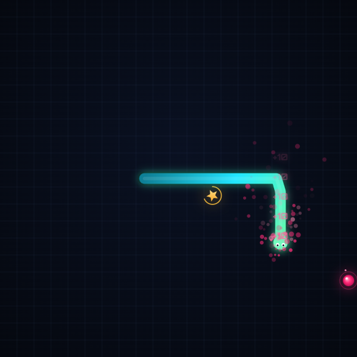

# 霓虹貪食蛇 NEON SNAKE

經典貪食蛇的現代霓虹重製版。深色科技風格、流暢的 Canvas 動畫、粒子特效與合成音效，單一 HTML 檔案、零依賴，打開即玩。支援電腦鍵盤與手機觸控操作。



## 遊戲特色

- **經典核心玩法** — 吃食物變長加分，撞牆或撞到自己即結束
- **漸進式難度** — 每吃 5 個食物提升一級速度（LV 1–9），挑戰反應極限
- **黃金星星獎勵** — 限時 6 秒的隨機獎勵食物，把握機會拿下 +50 分
- **最高紀錄保存** — 使用 `localStorage` 自動保存本機最高紀錄，破紀錄時顯示「新紀錄」徽章
- **完整遊戲流程** — 開始、暫停／繼續、重新開始、Game Over 結算畫面
- **遊戲感回饋** — 平滑移動插值、進食粒子爆發、分數飄字、死亡畫面震動、速度提升提示
- **合成音效** — Web Audio API 即時合成，無需任何音訊檔案，頂部按鈕一鍵靜音
- **響應式設計** — 桌面雙欄介面、手機直式單欄附觸控方向鍵，各種螢幕尺寸都能玩

## 操作方式

| 操作 | 電腦 | 手機 |
| --- | --- | --- |
| 移動 | 方向鍵 `↑` `↓` `←` `→` 或 `W` `A` `S` `D` | 畫面上滑動，或點觸控方向鍵 |
| 暫停／繼續 | `Space` 或暫停按鈕 | 暫停按鈕 |
| 開始／重新開始 | `Enter` 或畫面按鈕 | 畫面按鈕 |

蛇不允許直接反方向移動；切換分頁時遊戲會自動暫停。

## 遊戲規則

| 項目 | 說明 |
| --- | --- |
| 一般食物 | +10 分，蛇身 +1 節 |
| 黃金星星 | +50 分，蛇身 +1 節，每 5 個食物出現一次，限時 6 秒 |
| 速度等級 | 每 5 個食物升一級，移動間隔從 150ms 最快降至 65ms |
| 結束條件 | 撞上牆壁或自己的身體 |
| 獲勝條件 | 填滿整個 21×21 棋盤 |

## 快速開始

整個遊戲只有一個 `index.html`，不需要安裝任何東西。

**方法一：直接開啟**

雙擊 `index.html`，用瀏覽器打開即可遊玩。

**方法二：本機伺服器（推薦）**

```bash
# Python 3
python -m http.server 8000

# 或 Node.js
npx serve .
```

然後在瀏覽器開啟 `http://localhost:8000`。

## 部署到 GitHub Pages

1. 將本專案推送到 GitHub 儲存庫
2. 到儲存庫的 **Settings → Pages**
3. **Source** 選擇 `Deploy from a branch`，Branch 選擇 `main`（或 `master`）的 `/ (root)`
4. 儲存後等待約 1 分鐘，即可透過 `https://<你的帳號>.github.io/<儲存庫名稱>/` 遊玩

## 技術說明

- **HTML5 Canvas** — 遊戲渲染，支援高解析度螢幕（devicePixelRatio 最佳化）
- **原生 JavaScript** — 固定時間步進遊戲邏輯 + `requestAnimationFrame` 渲染，移動採插值平滑化
- **CSS3** — 霓虹漸層、光暈、掃描線、粒子背景，RWD 響應式排版
- **Web Audio API** — 振盪器即時合成音效，無外部音訊檔
- **localStorage** — 最高紀錄與靜音設定持久化
- **零依賴** — 沒有框架、沒有建置步驟，單一檔案直接執行

## 專案結構

```
neon-snake/
├── index.html      # 遊戲本體（HTML + CSS + JavaScript 單檔）
├── screenshot.png  # 遊戲畫面截圖
├── README.md       # 本說明文件
└── LICENSE         # MIT 授權
```

## 瀏覽器支援

Chrome、Edge、Firefox、Safari 等現代瀏覽器（桌面與行動裝置皆支援）。

## 授權

本專案採用 [MIT 授權](LICENSE)，歡迎自由使用、修改與散布。